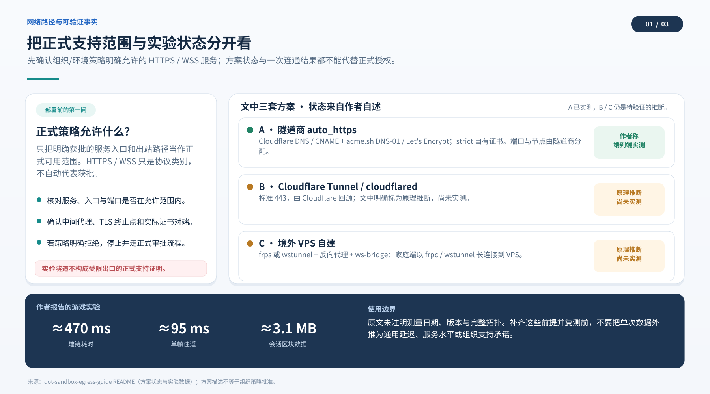
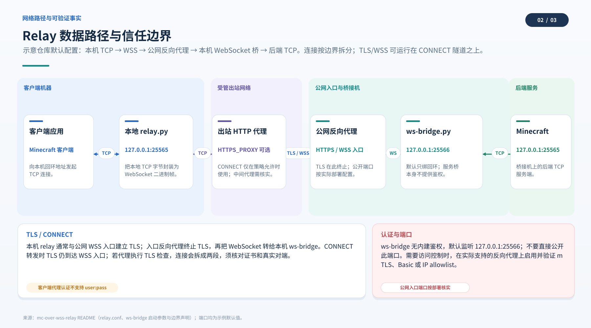
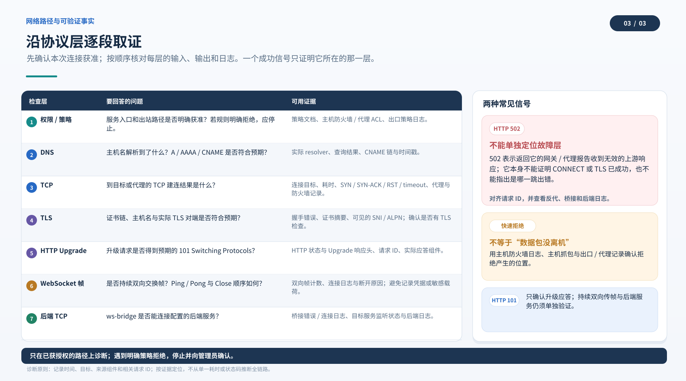

# 沙箱出网指南：按协议选路，按证据排障

这份指南整理了一次 dot 沙箱出网实验的观察，并把它改写成可复用的排查路径。文中的网络结论只描述作者当时记录的环境；代理策略、TLS 终止位置、协议版本和端口规则都可能因运行环境而异。遇到不同现象时，先重新测量，再决定怎么搭。

## 先选路线

| 要连接的服务 | 可先尝试的方式 | 主要前提 |
| --- | --- | --- |
| HTTP API、网页、REST | 直接使用 HTTP(S) 客户端 | 出口代理和目标策略允许该请求；API 凭据按服务要求配置 |
| WebSocket 服务 | 使用服务原生的 `wss://` 客户端 | 出口策略允许 WebSocket；应用自行处理断线和重连 |
| Minecraft、SSH、数据库等原始 TCP 服务 | 本地 TCP-to-WebSocket 中继，再由服务端桥接回 TCP | 有获授权的公网入口、反向代理和目标服务；要接受额外时延及两端运维 |
| UDP 或需要外部主动连入沙箱 | 先核对当前环境是否提供对应通道 | 本次记录的方案没有验证 UDP 或入站连接；可评估由沙箱主动轮询或改用受支持的协议 |

`wss://` 是经 TLS 保护的 WebSocket 连接。它把应用数据放入 WebSocket 帧，并不会自动放宽代理规则，也不表示路径上的设备一定看不到流量。是否能建立连接、在哪一层结束 TLS、代理是否能检查内容，都取决于实际路由、证书信任和配置。WebSocket 可以承载在不同 HTTP 版本上；HTTP/1.1 常见做法是 Upgrade，HTTP/2 和 HTTP/3 也有各自的扩展 CONNECT 机制。[RFC 6455](https://www.rfc-editor.org/rfc/rfc6455)、[RFC 8441](https://www.rfc-editor.org/rfc/rfc8441)、[RFC 9220](https://www.rfc-editor.org/rfc/rfc9220)

## 这次实验记录了什么

作者的记录把沙箱出口概括为三点：直接 TCP 连接曾很快失败；通过代理的 `CONNECT` 能为若干测试目标建立隧道；HTTP 与 WebSocket 路径可用，而原始非 HTTP 载荷没有得到预期响应。它们是特定环境中的观察，不是所有 dot、代理或目标都遵循的规则。原仓库没有附完整抓包、代理日志、测试环境清单或复现脚本输出，因此以下解释应作为排查线索。

- **快速拒绝只是一条线索。**失败耗时短，不能单独证明请求没有离开本机，也不能定位拒绝发生在本地策略、路由、代理还是远端。若要区分，应在获授权的端点对照 DNS、路由、TCP 建连、TLS 握手、HTTP 响应和各跳日志。拒绝时间只是综合时延的一部分。
- **`CONNECT` 不是“任何端口必通”的保证。**代理可以按目标、端口或身份限制隧道。只有当前代理的返回码、目标侧日志和成功的后续握手，才能说明这一次连接走到了哪一步。
- **HTTP 状态码要结合来源判断。**`502 Bad Gateway` 表示某个充当网关或代理的 HTTP 服务器认为其上游响应无效；状态码本身没有指出是哪台设备、哪一跳或哪种底层原因。查看响应头、请求 ID、代理链和源站日志后再归因。[RFC 9110 §15.6.3](https://www.rfc-editor.org/rfc/rfc9110#section-15.6.3)
- **TLS 可能在中间代理处终止。**若客户端信任代理签发的替代证书，且代理按配置解密，代理就可能检查 TLS 内的 HTTP 或 WebSocket 内容。mitmproxy 当前文档说明它支持 WebSocket 消息解析；这不代表任意 TLS/WSS 路径都能解密，实际还受客户端信任、版本、模式和协商扩展影响。[mitmproxy 协议文档](https://docs.mitmproxy.org/stable/concepts/protocols/)、[证书文档](https://docs.mitmproxy.org/stable/concepts/certificates/)

因此，原文中的“语义门”适合作为对**这次代理配置**的工作假设：在那条测试路径上，代理可能按 HTTP/WebSocket 语义处理流量。它不是对全部代理产品、端口或 WSS 的普遍描述。遇到明确的策略拒绝，应由有权限的网络或服务所有者确认授权路径。

## 按证据选择公网入口

原实验中只有方案 A 被作者标为端到端实测；B、C 是待验证方案。请把验证状态和配置建议一起阅读：

| 方案 | 原记录状态 | 用途与代价 |
| --- | --- | --- |
| A：隧道商 `auto_https`、自有证书、反向代理 | 作者称已测试证书签发、WebSocket 升级和一次完整会话；README 未附测试日期、工具版本或原始日志 | 上手较快；入口端口和节点由服务商提供 |
| B：Cloudflare Tunnel | 作者明确标为“原理推断，尚未实测” | 可减少自管公网机器，但需要按当前服务计划、路由和代理行为实际验收 |
| C：境外 VPS 自建 | 作者明确标为“原理推断，尚未实测” | 自己管理入口、反代、证书、进程和更新；运维责任也由自己承担 |

原方案使用域名，是因为它采用 CNAME 指向隧道入口并通过 DNS-01 自动申请证书。不要再把“公共 CA 不能给 IP 签证书”当作现行普遍事实：截至 2026-10-11，Let’s Encrypt 已一般开放 IPv4/IPv6 地址证书；这类证书必须使用 `shortlived` profile，有效期约 160 小时，且 IP 证书只支持 HTTP-01 或 TLS-ALPN-01 验证，不支持 DNS-01。具体 ACME 客户端、自动续期和反向代理是否支持，仍要逐项确认。[Let’s Encrypt 公告，2026-01-15（2026-03-11 更新）](https://letsencrypt.org/2026/01/15/6day-and-ip-general-availability)、[首张 IP 证书说明](https://letsencrypt.org/2025/07/01/issuing-our-first-ip-address-certificate)

所以，这份配方仍可优先用域名：它匹配当前 A 方案的 CNAME 与 DNS-01 流程，续期也更符合多数现有工具的默认路径。若改用 IP 证书，要另行确认验证方式和短周期续期自动化，不要把它直接替换进未经验证的流程。

## 原始 TCP：Minecraft over WSS 的结构

Minecraft Java 客户端会连本机 TCP 端口；中继把字节编码为 WebSocket 二进制帧，通过 TLS 连接到公网入口。服务端反向代理完成 TLS，并把 WebSocket 请求交给 `ws-bridge.py`；桥再将帧负载转发给真正的 TCP 服务。

这个结构解决的是协议适配问题：它不是“让 TCP 变成 HTTP”，也不证明任意代理都会放行。若代理要求鉴权、拒绝目标或不支持所需握手，应检查授权和代理配置；不能把 WebSocket 描述成绕过检查的方法。

### 作者报告的实验数值

原指南报告：建链约 **470 毫秒**、稳态单帧往返约 **95 毫秒**、一次会话传输约 **3.1 MB** 区块数据。改稿保留这些数值，但原仓库未给出测试日期、客户端/服务端版本、运行地区、链路、样本数或测量方法；它们是作者报告的单次实验记录，不能据此预测其他网络的延迟或稳定性。建议作者补上这些前提后再作为复现实验发布。

## 排障时按层记录

一次 WSS 会话可能经过本地 TCP、代理 CONNECT、TLS、HTTP/WebSocket 握手、反向代理和服务端 TCP 等多个阶段。代理也可能终止前一段 TLS，再单独连接上游；客户端的 TCP 对端不一定就是应用源站。先用日志或观测确认每一步，再解释失败。

| 观察到的现象 | 可以确认什么 | 下一步证据 |
| --- | --- | --- |
| 本地 TCP 连接失败 | 本地监听地址、端口或进程可能不匹配 | 检查监听进程、地址和客户端目标 |
| 出现 `CONNECT` 的 403/407 或其他拒绝 | 收到响应的一方拒绝或要求代理认证；单凭代码无法确认规则来源 | 保留完整状态行、响应头和代理日志，请代理所有者核实 |
| TLS 证书校验错误 | 当前 TLS 客户端未能验证它收到的证书链或目标身份 | 记录目标主机名、证书链、SNI、系统根证书和 TLS 对端 |
| WebSocket 升级未返回 101（HTTP/1.1 路径） | 经典 Upgrade 未成功；其他 HTTP 版本可能用不同的握手机制 | 核对路径、Host、反代配置和握手响应；保留请求 ID |
| 返回 502 | 某个网关/代理认为上游响应无效 | 对照响应头、该网关日志、上游服务日志和时间戳；不要直接归因于“后端非 HTTP” |
| 握手成功后无数据或断开 | 握手通过不等于应用协议和会话均正常 | 对照两端字节计数、服务端应用日志、心跳/空闲超时和关闭帧记录 |

WebSocket 会因网络中断、节点重启或空闲超时而结束。Cloudflare 文档列出网络更新和空闲连接关闭等情形；RFC 6455 规定底层传输意外丢失时连接失败。是否重连、重放消息或恢复会话属于应用设计，需要按业务单独实现。[Cloudflare WebSockets 文档（2026-08-14 更新）](https://developers.cloudflare.com/network/websockets/)、[RFC 6455 §7.2.1](https://www.rfc-editor.org/rfc/rfc6455#section-7.2.1)

## 认证与暴露面

公网入口应只开放实际需要的协议和路径，并由服务端或反向代理实施适合该服务的访问控制。中继代码本身是否实现认证，要看具体组件；本案例的 `ws-bridge.py` 不做鉴权，README 提到的 HTTP Basic、mTLS、IP 白名单等是**反向代理层的配置建议**，不是脚本已经启用的功能。

Basic 是 HTTP 层认证，凭据以 Base64 编码放进 HTTP 头，Base64 本身不加密；mTLS 是 TLS 客户端证书认证，由当前 TLS 终止端请求并验证证书。若代理在边缘终止 TLS，源站不会自动继承客户端在前一段 TLS 中提供的证书身份。部署前确认是哪一层接收、验证并向应用传递身份。[RFC 7617](https://www.rfc-editor.org/rfc/rfc7617)、[RFC 8446 §§4.3.2, 4.4.2](https://www.rfc-editor.org/rfc/rfc8446)

## 复现实验时补齐这些信息

- 日期和时区；dot/沙箱、客户端与服务端软件版本；所用代理及模式。
- 目标是域名还是 IP，DNS 结果、HTTP 版本、TLS 版本和证书身份；隐去真实地址和凭据。
- 每个阶段的命令、退出码、原始状态行/响应头、代理与服务端对应日志。
- 测量方法、样本数、是否含 DNS/CONNECT/TLS/Upgrade 往返，以及流量大小的定义。
- 明确标注哪些路线亲测，哪些是推断；未运行的路线不要写成已验证。

## 来源与版本

本稿依据主指南固定公开快照 `5e7bc0806271ce0a3ef0c1e8d2f2b84a1a67c583` 与中继案例固定公开快照 `6b98173e835a8f7d23166669878032e49c821b55`；代码审查见[案例说明](docs/relay-case-study.md)，协议与产品事实来源见[来源清单](docs/sources.md)。这些固定版本用于说明本次编辑依据，不代表上游仓库此后没有变化。
