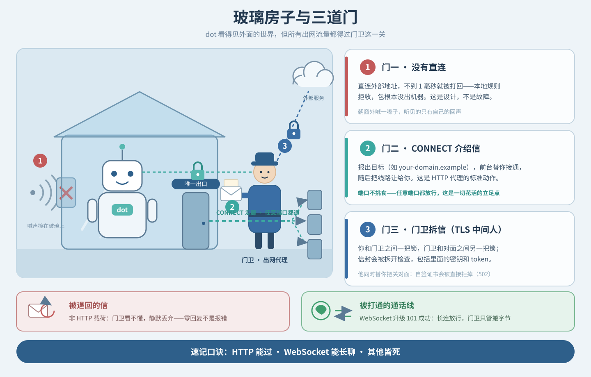
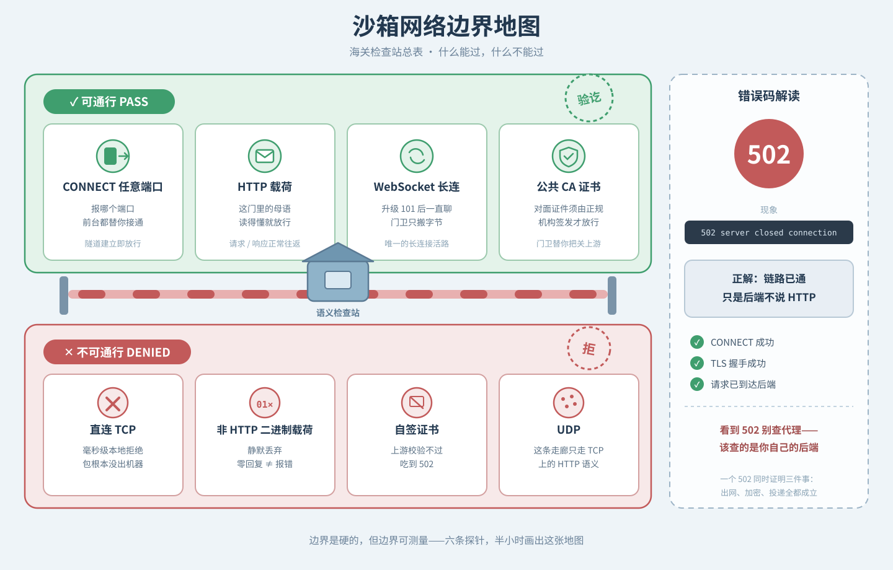
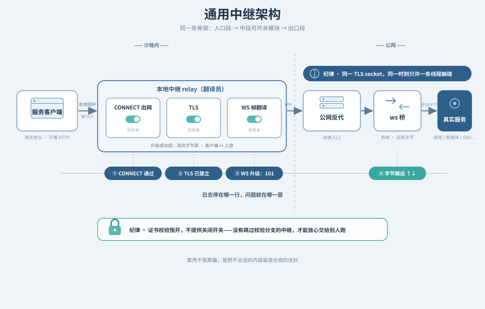
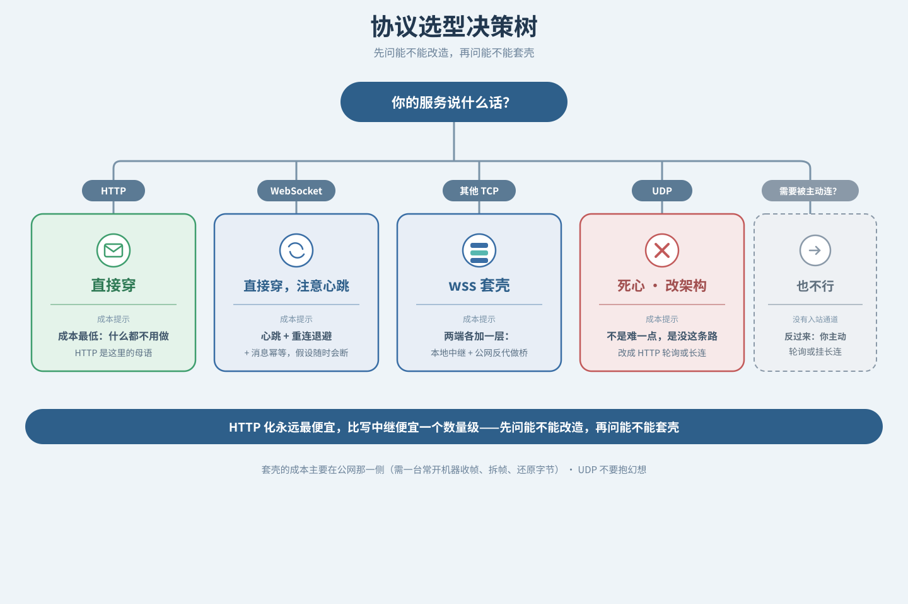

# dot 出海指南：沙箱 AI 连接外部服务的通用教程

## 一、结论速览

如果你只读一节，读这节。

先说清我们要解决什么。dot 能读文件、能写代码、能跑命令，看起来无所不能；可一旦让它连外部服务，答案往往是一句委屈的「连不上」。你 ping 不通、socket 一连就报错——而且**快得可疑**：不是卡着等超时，是**瞬间**被拍回来。这不是 dot 笨，也不是你代码写错了：它住在一间**玻璃房子**里，四面看得见外面，却没有一扇开向外的窗，只有一扇由门卫把守的大门——而这扇门，比你想象的挑食得多。

**一句话结论：**

> **HTTP 能过，WebSocket 能长聊，其他皆死；服务端挂真证书。**

**「过不过」其实是三层闸门串联：**

1. **网络层**——沙箱里没有直连，出站强制走代理（CONNECT），但**端口不挑食**，任意端口都能通；
2. **内容门**——代理会拆开 TLS 看内容，只放行 **HTTP 语义**：裸二进制进去零回复，HTTP 正常，**WebSocket 升级（101）放行**；
3. **dot 的安全甲**——行为层的闸：网络全通、证书全真，dot 仍可能因为「这是明文 http，不安全」而拒绝连接，**没有报错，只有一句「我不建议这样做」**。

第 3 层推出了那条铁律：**服务端一律 https + 公共 CA 真证书**——不是门卫要求的（http 和 https 它对内都放行），是 **dot 自己的安全直觉**要求的。

**边界速览**（图2 的文字版，完整判定方法见第四章）：

| 能过 | 不能过 |
| --- | --- |
| 任意端口的 CONNECT（隧道能建立） | 直连 TCP（毫秒级本地拒绝，不是超时） |
| HTTP / HTTPS 请求 | 裸二进制载荷（零回复，不是报错） |
| WebSocket 升级后的长连接 | 自签证书的上游（502） |
| 经反向代理的隧道流量 | UDP；以及任何「别人主动连你」的入站连接 |

**一个必须记住的错误码：**`502 server closed connection` 不是「网络断了」，而是**链路完全通了、但后端不说 HTTP**——它同时证明 CONNECT 成功、TLS 握手成功、请求已到达后端三件事。

**本文怎么读：**

- **想直接开干** → 第二章「可复用实现配方」，三套方案照单选一；
- **想搞懂为什么** → 第三章「小白解说」，三道门 + 三层闸门 + 三种姿势，没有一行代码；
- **要自己测绘边界、排障、或写中继** → 第四章「专业解说与实测证据」，六条探测 + 通用中继架构 + 排障决策树；
- **要派活给 dot** → 附录 A 的 prompt 模板。

全文不出现任何具体机器的地址，示例域名一律写作 `your-domain.example`。

---

## 二、可复用实现配方：三套方案

第一章讲的是「为什么」，这一章直接给「怎么做」。三套方案都建立在同一条铁律上——**服务端一律 https + 公共 CA 真证书**——差别只在「证书谁来签、公网入口谁来提供」。选题原则很简单：**先选入口，再配证书。**

### 方案 A · 隧道商 auto_https（免费起步首选，也是验证过的那条路）

最小配置是三件套：

1. **一个域名。**公共 CA 证书必须绑定域名（签给裸 IP 的证书拿不到），所以域名是必需品——后缀便宜的完全够用，买它唯一的理由就是「让证书签得出来」。
2. **DNS 托管在 Cloudflare。**它负责两件事：
   - 加一条 CNAME 指向隧道商给你的节点地址；
   - 用 acme.sh 走 **DNS-01** 方式向 Let's Encrypt 申请并自动续期证书。**高端口场景下 HTTP-01 走不通**（校验回调落不到你的机器上），DNS-01 是唯一姿势。
   - 严格说，任何「DNS 有 API 能写 TXT 记录」的服务商都行，Cloudflare 只是免费档里最顺手的那个。
3. **隧道商侧开启 auto_https 并挂上自有证书**，策略选 **strict**：只认你自己的证书，防止证书没挂上时静默回落到自签——那一下回落，dot 的安全甲会当场把你拦下。

好处：全程免费档够用，证书自动续期，人不在机器前也活得下去。代价：**端口与节点由隧道商分配**，想用什么端口得看它的脸色，高峰期还会受节点负载影响。

### 方案 B · Cloudflare Tunnel（只有 dot 用的话，最偷懒）

**更懒的备选：Cloudflare Tunnel。**cloudflared 一条命令，证书全自动、走标准 443，连 acme.sh 都省了。代价是流量要过 CF 回源，国内访问会慢，所以它只适合「只有 dot 用」的服务。如果「国内的朋友也要用」，还是隧道双入口（国内腿 + 海外腿）更稳。

### 方案 C · 境外 VPS 自建（长期正经干）

想要「入口完全属于自己」，就把公网那一头搬到一台**境外 VPS** 上：租一台最小的机器，自己跑 frps（或 wstunnel）加一个反向代理，再把 ws 桥放上去。

- **掌控感**：公网入口、端口、带宽、节点负载全在自己手上，不必依赖隧道商的端口分配与线路质量；
- **隐藏福利**：VPS 有标准的 80 与 443 端口，签证书**可以直接走 HTTP-01**——连 Cloudflare DNS 与 acme.sh 那套 DNS-01 流程都省了；
- **同源的概念**：家里到 VPS 的回程，仍然是一条 frpc / wstunnel 长连，和方案 A 是同一套思路，只是「隧道商」换成了你自己的机器；
- **代价**：每月几美元的机器钱，外加**运维得自己扛**——证书续期、进程守护、开机自启，一样都少不了。

适合：长期跑、要挂不止一个服务，或者单纯不想再看隧道商脸色的场景。

### 选型建议

**免费起步选 A，纯 dot 偷懒选 B，长期正经干选 C。**三套方案的证书逻辑完全一致，随时可以从 A 迁到 C：入口换了，证书配置与 dot 那一侧的设置一行都不用动。

---

## 三、小白解说：三道门与三种姿势

第一章已经把结论给了。这一章回头补「为什么」——不写一行代码，把边界讲成一个你能复述给别人的故事。
先讲门，再讲姿势：门决定「什么能过」，姿势决定「你要的东西该怎么过」。

### 上篇：三道门

把 dot 的网络想成一间**玻璃房子**：房子透明（它知道外面有什么），但它自己出不去。房子只有一扇门，门口站着门卫，所有出网流量都得经过他。他给你设了三道门。

#### 门一：没有直连

第一道门最简单粗暴：**房子外面没有路。**

你试图直接和外面某个地址建立 TCP 连接，结果不是「等一会儿超时」，而是**不到 1 毫秒**就被拒绝。

这个「快」是重要信号：对方只是**没在听**的话，TCP 会慢慢超时、你得等好几秒；而这里遇到的，是**本地**有条规则直接把包打回去（技术上叫 REJECT）——好比朝窗外喊一嗓子，声音撞在玻璃上弹回来，你听见的是自己的回声。

所以「直接连 IP 和端口」在 dot 里都是死路。**这是设计如此，不是故障。**

#### 门二：门卫带你走一条走廊，但走廊通到哪都行

出不去，就走门卫的通道。它叫 **CONNECT**，像酒店前台：你不能自己上楼，但可以说一句「麻烦帮我接一下 `somewhere.example` 的某个端口」，前台替你去接，接上了就把线路让给你，之后你顺着这条线说话，他不再插嘴。两点必须记住：

1. **这是 HTTP 代理的标准动作**，不是黑科技——你在公司上网时浏览器做的就是同一件事。
2. **端口不挑食。**你报哪个端口，只要对面有服务在听，前台都会替你接通。这一点极其关键，是后面所有花活的立足点。

#### 门三：门卫会拆你的信

你以为上了 TLS 就端到端加密、谁也看不见？天真。真实情况是：**你和门卫之间一把锁，门卫和对面之间另一把锁。**

你看到的「对面」其实是门卫本人。他拿一张自己签发的证件给你看（签发者不是对面域名对应的正常机构，而是代理服务商自己）；你信了，把话说给他听，他拆开看看、再重新封一封，送给真正的对面。

这叫 **TLS 中间人**，是企业出网网关的常规做法（用于审计与合规），不是邪恶手段。它给你两个硬结论：

- **别指望端到端加密能保护这一跳上的内容。**门卫看得见你信里的每个字，包括密钥和 token——「不要把不该出沙箱的东西发出去」是**你自己的责任**。
- **门卫在替你把关对面。**他找真正的对面时会核对对方证件；对面若掏出一张自己画的假证（自签证书），门卫直接拒绝——那个错误就是本文反复提到的 **502**。

#### 规矩：门卫只收「书信格式」

出得去、也通了 TLS，那你能说什么？答案是：**门卫只认 HTTP。**

推论很锐利：门卫拆开信后会**按 HTTP 语法去读**。正经 HTTP 请求他读得懂、转给对面、再把回话带回来；可你要是塞进去一坨**不是 HTTP 的东西**——比如某个游戏协议的原始握手包，几十字节的二进制——门卫拆开一看「这是什么」，然后**什么也不回**。

不是报错，不是拒绝，而是**沉默**，极易被误判成「网络卡住了」；其实对面可能压根没收到，因为门卫根本没转发。

> 快速判断法：在同一条链路上发一个 `GET /` 试试。HTTP 正常、二进制沉默，答案就清楚了。

#### 唯一的例外：视频通话

门卫虽然只收信，却认得一种特殊请求：写着「请把这条连接**升级**成实时双向通话」的 HTTP 请求。这叫 **WebSocket 升级**。

一旦升级成功（对面回 `101 Switching Protocols`），你和对面就能**一直聊下去**，门卫不再逐句检查内容，他只做一件事：**搬字节**。这是玻璃房子里唯一的「长连接活路」。

它为什么重要？因为沙箱 AI 有个致命缺陷：**它不能被别人主动连**——没有稳定公网入口，会话随时可能被回收。WebSocket 解决了它：**由 dot 主动打出去，再把这条线一直挂着**，消息照样双向流动，只是方向反过来。

> **速记口诀：HTTP 能过，WebSocket 能长聊，其他皆死。**



*图注：半透明玻璃房子，内坐小机器人，唯一一扇门外站着门卫。三层信息：外墙回荡的声波（无直连）；门卫牵着走廊通向外部多扇门、标注「任意端口都可通」（CONNECT）；门卫手持拆开的信、两条不同颜色锁链分连房内与对面（TLS 中间人）。角落两个剪影：被退回的信与被打通的通话线。*

#### 但别忘了第三层闸门：dot 自己的安全甲

上面三道门讲的都是「网络过不过得去」。真实的关卡其实是**三道闸串联**：

1. **沙箱网络层**——直连一律 REJECT，出站强制走代理（门一、门二）；
2. **代理内容门**——mitmproxy 在中间拆信，只认 HTTP 语义（门三与「书信格式」）；
3. **dot 自己的安全甲**——**行为层**的闸，跟网络一点关系都没有。

第三道闸最容易被忽略：哪怕网络全通、证书全真，dot 也可能因为「这是明文 http，不安全」而**拒绝连接**。它不会给你超时、不会给报错，只会回你一句「我不建议这样做」。

所以工程上有一条硬结论：**给 dot 用的服务，一律 https + 公共 CA 真证书。**这不是门卫要求的（http 和 https 它都放行），是 **dot 自己的安全直觉**要求的。门卫放行了，dot 自己也可能不肯走。

好消息是这条约束不额外加成本：wss 套壳本来就必须用真证书，**一张证书全家通吃**——HTTP API、WebSocket 长连、套壳隧道，全凭它过关。

### 下篇：三种姿势

门看完了，回到实操：你的服务属于哪一类？下面三种姿势按难度递增，难度越高，需要自己动手的地方越多。

#### 姿势一：HTTP API 型（最容易，先从这个开始）

**典型场景：任务队列。**dot 不能长跑、不能常驻、也不能被连，所以最自然的架构是反过来：**让 dot 主动出去接活**——定期问一次「有活吗」，有就取走，干完交回结果。三个细节决定它是玩具还是能用的东西。

**一、长轮询，而不是死循环轮询。**发出请求后若若干秒内没任务，服务端**先不回复**、把连接挂着；有任务立刻回，超时了回空响应。等待时间要比链路各环节的超时都短一点，否则会等到一半被中间设备掐断。

**二、租约加状态机。**给任务记一个截止时间，到期没回填就自动打回队列重新分配；状态走 待处理 → 处理中 → 完成 / 拒答 / 失败。后果是——**回填必须幂等**：旧的那个 dot 可能在你重新分配后又活过来交结果，服务端要认出「这条已经不是你的了」并拒绝。

**三、「拒答」要是一等公民。**AI 有权说不：任务超出能力范围时应明确回「我拒绝，理由是……」，而不是沉默或硬编答案。只会「完成」与「失败」的队列会把拒答算成失败，于是重试逻辑会不停地把一条已拒绝的任务再派一遍。

> 姿势一总结：**HTTP 是这里的母语，别跟它对着干。**

#### 姿势二：WebSocket 长连型（聊天机器人）

**典型场景：QQ 机器人。**平台给你一个 wss 地址：你连上去，它把群消息推给你，你把回复推回去——整个过程你是**客户端**。

为什么必须这样？回到那个结构性缺陷：dot 没法被连，**任何「你给我一个回调地址」的方案都行不通**。连接必须由 dot 主动发起并一直挂着。一个不会天天断线的机器人至少要处理四件事：

1. **心跳**：很多网关 30~60 秒没数据就把你踢掉，要定期主动发心跳帧。
2. **重连退避**：别疯狂重连（只会被限流）——第一次 2 秒，之后翻倍，封顶几分钟。
3. **消息幂等**：重连后平台可能把断线期间的消息重发一遍，逻辑要认出「这条处理过了」，否则朋友会在群里看你把同一个梗讲两遍。
4. **假设随时会断**：该落盘的状态别留在内存里。

> 姿势二总结：**你没法被找到，所以你必须自己一直在线。**

#### 姿势三：任意协议的 wss 套壳（Minecraft 案例）

**适用场景**：对面说的是一个**与 HTTP 毫无关系**的协议——游戏、数据库、消息队列、SSH 都算。

Minecraft 客户端只会说自己的协议，它**不知道什么是 HTTP**，也不会「走代理」，只会对着一个 IP 和端口吐出一串二进制；而门卫只认 HTTP 语义——裸二进制进去，零回复。

怎么让一个不懂 HTTP 的东西通过一扇只认 HTTP 的门？**在你自己的机器上放一个翻译员，把原始字节流装进 WebSocket 帧里。**这就是**套壳**。

```
Minecraft 客户端
      |  裸 TCP -> 本机 127.0.0.1 的默认游戏端口
      v
  本地中继 relay（翻译员）
      |  CONNECT 出沙箱 -> TLS -> WebSocket Upgrade -> 101
      |  此后：MC 的每个字节，装进一个 WebSocket 二进制帧
      v
  公网一侧：反向代理 -> ws 桥 -> Minecraft 服务端
```

三段的理由：**入口段**让 MC 客户端以为自己在连一台本机服务器——**你不改客户端，你改它脚下的地面**，这是套壳最优雅的地方；**中段**让门卫看到的是一条完全合法的 wss 长连接；**出口段**由公网机器把帧拆开、还原成原始字节交给真正的服务端。

有人会问：这不就是「骗过门卫」吗？**不是。**套壳的本质是**如实遵守规矩**：门卫要求 HTTP 语义，我们就给一条标准合规的 WebSocket 连接；要求信封可读，我们的信封从头到尾都合规。他始终知道有一条 wss 连接挂着，日志里看得见——他只是不负责理解「这些字节是什么游戏协议」。**你没有绕过任何东西，你只是把不合适的内容装进了合适的信封。**

三个实测数据点：**建链约 470 毫秒**（从连上本地中继到升级完成，含 CONNECT、TLS、Upgrade 往返，是「能不能连上」的主要成本）；**稳态单帧往返约 95 毫秒**（升级完成后「发一帧、回一帧」的时延，即体感延迟）；**一次会话传输约 3.1 MB 区块数据**（跑图、放方块一路稳定，没有断）。

新手必踩的坑：**WebSocket 的客户端帧必须带掩码**（客户端每一帧都要用随机 4 字节掩码、长度字节最高位置 1）；漏了这个位，很多服务端**直接断连，什么也不解释**——你会看到「连上了，然后立刻断了」，然后开始怀疑人生。

> 姿势三总结：**门卫只检查信封，不检查内容。**

## 四、专业解说与实测证据

小白版到此为止。接下来三节是给折腾党的：怎么自己把边界测出来、怎么把边界变成一套可复用的中继、以及坏了怎么定位。

### 一、边界测绘方法论：六条可复现的探测

这一节给出**怎么自己得出这些结论**——六条可复现的探测。

**探测一：直连测试（证明没有直连）。** 对某外部地址的常见端口发起最朴素的 TCP 连接，记录**错误类型**与**耗时**。毫秒级被拒 = **本地规则**拦截，包没出机器；长时间卡住再超时 = 网络不可达。前者是「这条路封死了」，后者是「路通着，只是对面没响应」。

**探测二：CONNECT 任意端口（证明门二不挑端口）。** 手工对代理发一条 `CONNECT host:port`，先试常见端口，再试一个高位端口。只要目标有服务在听就返回 `200 Connection established`——**端口不是限制条件**，不必把服务伪装到某个「正经」端口上。

**探测三：看证书的签发者（识破中间人）。** 走完 CONNECT 后建立 TLS，把**对端证书的签发者**打出来。签发者不是目标域名对应的正常机构、而是代理服务商自己，说明 TLS 在代理处终结。这不是漏洞而是设计——但它划定了安全边界：敏感凭据不要在这条路上裸奔。

**探测四：自签证书吃到 502（证明上游校验）。** 自己起一个 HTTPS 服务用自签证书，让代理去连它，会失败并给出 502 类错误。结论：代理向真正的上游发起 TLS 时**是校验证书的**，自签糊弄不了上游；而中间那一跳是被保护着的。

**探测五：三种载荷的对照实验（归纳语义门）。** 最有价值的一条。对**同一个目标端口**分别发：

| 载荷 | 现象 | 读法 |
| --- | --- | --- |
| 裸二进制（某协议原始握手包） | **零回复**，等到超时 | 载荷不是 HTTP，被静默丢弃 |
| 普通 HTTP 请求（`GET /`） | 正常响应 | HTTP 是这门里的母语 |
| WebSocket 升级请求 | `101 Switching Protocols` | HTTP 家族的长连接形态被放行 |

门槛**不在端口、不在加密，而在解密之后的载荷是不是 HTTP 语义**——这就是「语义门」。推论：因为检查发生在**解密之后**，「套层 TLS 藏在里面」没有意义。

**探测六：学会读 502。** 故意让上游给出不符合 HTTP 的响应，会拿到一个类似「502，服务端关闭了连接」的错误。正确读法是：

> **502 不是「网络断了」，而是「链路完全通了，但后端不说 HTTP」。**

它同时证明三件事：CONNECT 成功、TLS 握手成功、请求已到达后端。很多人看到 502 第一反应是查代理配置，方向完全反了——**该去查你自己的后端。**


*图注：海关检查站风格。上半部绿色「可通行」：任意端口的 CONNECT、HTTP/HTTPS 请求、WebSocket 长连接、经反代的隧道；下半部红色「不可通行」：直连 TCP（毫秒级本地拒绝）、裸二进制载荷（零回复非报错）、自签证书上游（502）、UDP、外部入站连接。右侧窄栏「错误码解读」：502 = 链路已通、后端不说 HTTP。*

边界测出来之后，下一件事是把它变成工程：下面这套中继架构，就是「路修好了」的样子。

### 二、通用中继架构与协议选型

#### 中继的通用形态

不管套什么协议，中继骨架都一样：

```
[本地裸 TCP 入口] -> [（可选）CONNECT 出网] -> [TLS]
                  -> [（可选）WebSocket 升级]
                  -> [双向字节泵：客户端 <-> 上游]
```

差别只在：中间两步做不做，以及**帧这一层怎么翻译**。按能力从窄到宽，中继通常支持四种模式：
| 模式 | 中间做了什么 | 什么时候用 |
| --- | --- | --- |
| 直连 | 什么都不做 | 本机联调，验证「翻译」这件事本身 |
| 裸 TLS | 套一层 TLS | 上游是「TLS + 原始协议」的旧式部署 |
| 走代理 | 加 CONNECT | 环境里有出网代理，上游仍是原始协议 |
| WebSocket | CONNECT + TLS + 升级 + 帧翻译 | 面对只认 HTTP 语义的门卫，这是**唯一活路** |

保留前三种是为了排障时对照：WebSocket 模式连不上时，你要能立刻回答「是 TCP 不通、TLS 不过、还是升级被拒」。

#### 五条设计纪律

**一、单文件、纯标准库。**中继要交给别人跑（甚至交给另一个 AI 跑），依赖越少交付越可靠——能 `python3 relay.py` 直接跑的单文件，比需要三步安装的工程靠谱得多。

**二、TLS 校验恒开，不提供关闭开关。**真的有人为了「先跑通」加一句「跳过校验」。**永远不要**——没有关闭校验分支的中继，才能放心交给别人。

**三、日志必须能被外人读懂。**出事时读日志的人很可能不是作者，所以：每条连接要有编号；关键里程碑单独打一行（连接、握手、升级、关闭）；失败要打出**异常类型 + 原因**；分级克制到三级。

**四、不做静默重试。**重试要显式、可见、有上限。偷偷重试三次再报错，排障的人看到的已经不是第一次那个错误了。

**五、同一个 TLS socket，同一时刻只能被一条线程碰。**两条线程一读一写共用一个 SSL 对象，**进程可能直接崩掉**（不是抛异常，是挂掉）：OpenSSL 内部状态在并发访问时会竞争。正确做法是连接内用**单线程** `select` 循环同时管读和写；还要处理一个隐蔽细节——SSL 层可能已把解密数据放进缓冲区，而 `select` 不知道（它只认 socket 层的可读性），必须主动检查缓冲里还有没有货。

#### 选型决策树

```
你要连的目标是什么？
│
├─ HTTP(S) API ────────────────> 直接用。什么都不用做。
│
├─ WebSocket ──────────────────> 直接用。配心跳 + 重连退避 + 消息幂等。
│
├─ 其它 TCP 协议 ──────────────> 能否接受「本地中继 + wss 套壳」？
│   （游戏 / 数据库 / MQTT…）      ├─ 能 ─> 套壳。公网侧需一台机器做反代 + 桥。
│                                  └─ 不能 ─> 换思路：改造成 HTTP 轮询，或放弃。
│
├─ UDP ────────────────────────> 死心。这条走廊只走 TCP 上的 HTTP 语义。
│
└─ 需要别人主动连你 ───────────> 也不行（没有入站通道）。改成：你主动轮询或长连。
```

**「HTTP 化」永远最便宜**，比写中继便宜一个数量级——先问能不能改造，再问能不能套壳；**套壳的成本主要在公网那一侧**（需一台常开机器收帧、拆帧、还原字节）；**UDP 不要抱幻想**，这不是「难一点」，是「压根没这条路」。



*图注：横向管道图。左端客户端（原生协议、不懂 HTTP），中间四个可开关模块（本地裸 TCP 入口 / CONNECT 出网 / TLS / WebSocket 升级与帧翻译），右端公网反代 → 协议桥 → 真正的服务端。每个模块下方标注它对应的排障日志里程碑；上方标纪律「同一时刻只有一条线程触碰 TLS socket」，下方挂锁形图标「TLS 校验恒开」。*



*图注：树形流程图。根节点「你要连的是什么？」，第一层四分支（HTTP(S) API / WebSocket / 其它 TCP 协议 / UDP），旁支加问「需要别人主动连你吗」。叶子用颜色区分结论：绿「直接用」、蓝「套壳（需公网反代）」、红「此路不通，改架构」，每叶配一句成本提示。*

架构与选型讲完，最后一节回到故障现场：怎么靠日志把问题定位到具体哪一层。

### 三、排障决策树：日志停在哪儿，问题就在哪儿

写得好中继会在每条连接上依次打印几个里程碑，这些行**顺序固定**，所以「日志停在哪一行」直接告诉你问题在哪一层。

**第一行 `CONNECT 通过`**——没到这一行，问题在出网层：代理拒绝（403 之类）说明目标没被放行或代理地址配错；超时说明目标端口没人听；地址解析失败说明目标写法不对（**要写成 host:port，缺端口会直接报错**）。

**第二行 `TLS 已建立`**——问题在加密握手层：证书校验失败说明上游证书有问题；对端根本不是 TLS 说明你连到了明文服务上。

**第三行 `WS 升级: 101`**——问题在信封层：被打回 200 或其它状态码，说明**对端根本没开 WebSocket**，或路径、Host 头写错了。

**第四行 搬运阶段（上行/下行字节统计）**——前三行全过但连接立刻关闭、或一个字节都没走，通常是三种情况：**对端在等你先说话**（不少服务先等首字节再回应，客户端沉默就会看起来「通了没反应」）；**载荷不被承认**（能连上 wss 不代表对面认你的协议）；**刚连上就断**（检查帧格式，尤其客户端帧的掩码位，这是新手第一大坑）。

**还有一种：前三行都过了、游戏也能连，但「进去就掉」。**这大概率**不是中继的问题**，而是服务端自己的规则——白名单、密码、版本不匹配：日志里能看到字节在正常双向流动，就说明桥已经把字节送到了。

**心法：先分层，再定位。**先看日志停在哪一层，把搜索空间砍掉四分之三。

## 五、附录 A：给 dot 派活的 prompt 模板

沙箱 AI 是执行者，但它不会读心。派活时把四件事写清楚，成功率会高很多：

1. **目标**：一句话说清要达成什么（不是「帮我搞一下网络」，而是「让本机某端口上的服务，能通过一条 wss 隧道被外部访问」）。
2. **环境事实**：把已知条件告诉它——「沙箱内没有直连出网，只有 CONNECT 代理可用」「目标协议不是 HTTP」。**这一步能省掉它一半的试错。**
3. **约束与交付物**：允许用什么（只能标准库）、禁止做什么（不得关闭 TLS 校验、不得引入第三方依赖）；交付要具体到文件名与形态。
4. **证据要求**：要**可复现的命令 + 原始输出**，而不是「我验证过了」——沙箱 AI 很容易把「我认为应该成功」说成「我验证过成功」。

最后加一句：**「如果前提与现场不符，停下来告诉我，不要自己改方案。」**

## 六、附录 B：探针脚本概念清单

| 探针 | 它回答的问题 | 关键观察点 |
| --- | --- | --- |
| 直连探针 | 有没有直连通道？ | 错误**类型**与**耗时**（毫秒级 = 本地拒绝） |
| CONNECT 探针 | 代理放行哪些端口？ | 返回码（隧道是否建立成功） |
| 证书探针 | TLS 到哪儿终结？ | 证书**签发者**是不是目标域名对应的机构 |
| 语义探针 | 门认什么载荷？ | 同一端口发三种载荷，对比「响应 / 沉默 / 升级成功」 |
| 上游校验探针 | 代理是否校验上游？ | 自签证书是否被拒 |
| 长会话探针 | 空闲多久会断？ | 「最后一次数据」到「连接关闭」的时间差 |

三个纪律：**每个探针只回答一个问题**；**每次尝试的退出码都留档**（不做静默重试，重试会掩盖第一次的真实错误）；**输入与输出原样记录**。

## 七、写在最后

三句话收尾：**边界是硬的，但边界可测量**——别猜，写六个探针，半小时就能把地图画出来；**HTTP 是这里的母语，WebSocket 是唯一的活路，其他一切靠套壳**；**套壳不是欺骗，是把内容装进合规的信封。**

沙箱 AI 被关得很死，但只要理解了那三扇门，能做的事情一点也不少。祝你把 dot 放出去的时候，一路绿灯。

## 配图清单

共四张图，统一风格：**扁平信息图 / 插画、冷色调、圆角，不含任何真实域名、IP 或端口数字**。图片在本文同级的 `figures/` 目录下，按相对路径引用；下表「锚点」列给出图片在重排后正文中的位置。

| 文件 | 锚点 | 一句话 |
| --- | --- | --- |
| `figures/fig1-glass-house.svg` | 第三章 · 上篇「三道门」结尾 | 玻璃房子与三道门：无直连 / CONNECT 任意端口 / TLS 中间人拆信，角落剪影对比「被退回的信」与「被打通的通话线」 |
| `figures/fig2-border-map.svg` | 第四章 · 边界测绘方法论结尾 | 网络边界地图总表：可通行与不可通行两栏对照，右侧窄栏解读 502 |
| `figures/fig3-relay-arch.svg` | 第四章 · 通用中继架构与协议选型结尾 | 通用中继架构：四个可开关模块、每段的排障日志里程碑与两条设计纪律 |
| `figures/fig4-protocol-tree.svg` | 第四章 · 同上（紧随图3） | 协议选型决策树：三色叶子给出「直接用 / 套壳 / 改架构」 |

另有四个同名 PNG 版本（文件名同上、扩展名为 `.png`），供不支持 SVG 的平台直接嵌入。

## 隐私自查声明

本文以陌生读者视角撰写，**不含任何私有坐标**。已逐类检索确认：

| 检查类别 | 结果 |
| --- | --- |
| 真实域名（隧道 / 服务 / 反代域名） | 0 命中；示例一律写作 `your-domain.example` |
| IP 地址 | 0 命中；仅出现回环地址 `127.0.0.1`（通用本地约定） |
| 端口号、人名、账号名、沙箱名或容器名 | 0 命中 |
| 服务器名、主机名、网络拓扑描述 | 0 命中 |
| 服务凭据、token、证书指纹、地区与线路信息 | 0 命中 |

保留内容均为公开可考的技术名词与协议名，以及可复现的实测数值（毫秒级耗时、传输体积），不构成对任何具体部署的定位。
